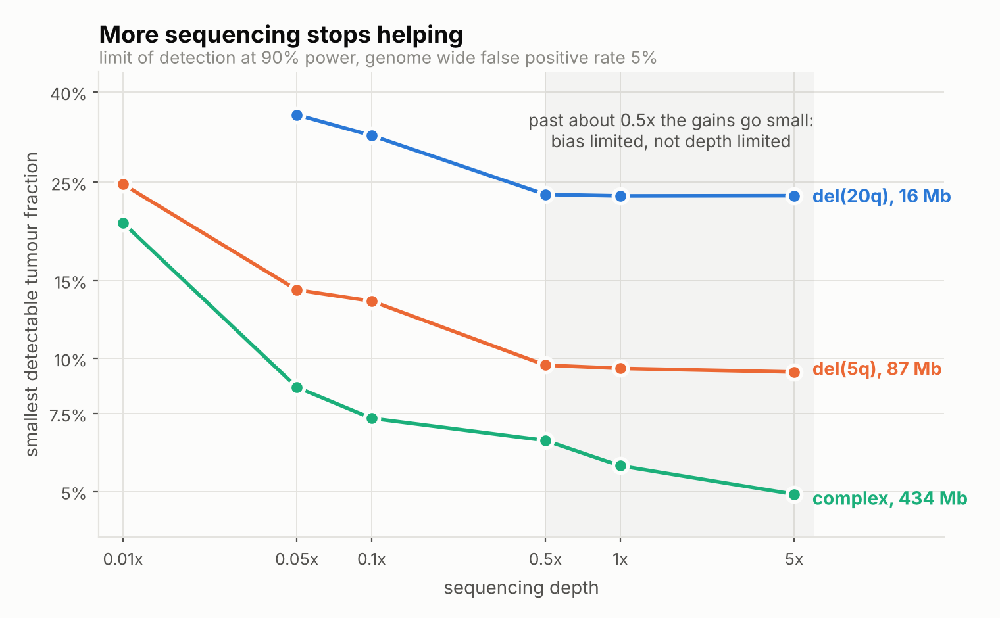
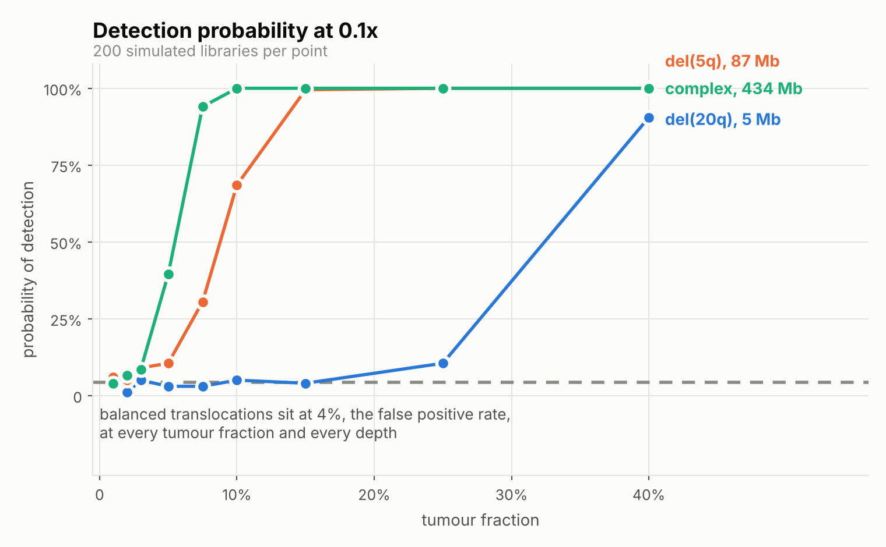
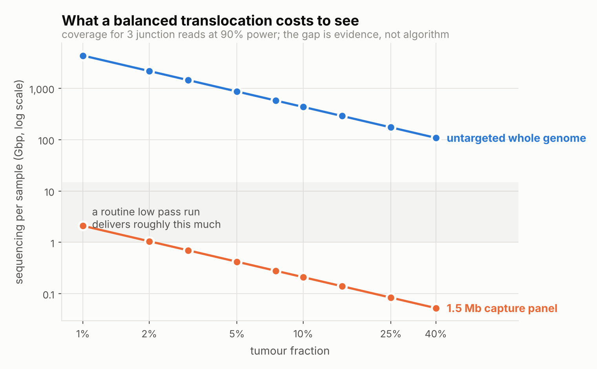

# Results

Three findings, ordered by how much they should change what someone does.

Everything below comes from `results/sweep.csv`: 648 conditions, 200 simulated
libraries each, 129,600 detector calls, with the genome wide false positive
rate held at 5 percent by calibration against 2,000 held out normal libraries
at every depth. Reproduce with `lpcfdna sweep && lpcfdna summary`.

## 0. The false positive rate really is controlled

Before any sensitivity claim means anything, the specificity has to be pinned
down and shown.

| Depth | Threshold | Target FPR | Achieved FPR |
|---|---|---|---|
| 0.01x | 5.00 | 5% | 5.7% |
| 0.05x | 5.07 | 5% | 5.0% |
| 0.1x | 5.82 | 5% | 3.7% |
| 0.5x | 6.67 | 5% | 5.3% |
| 1x | 6.67 | 5% | 5.6% |
| 5x | 7.21 | 5% | 5.5% |

Achieved rates are measured on 1,000 normal libraries that neither the panel
nor the calibration set has seen. They average 5.1 percent and scatter from 3.7
to 5.7 percent, which is quantile estimation noise rather than bias: the
standard error on a 5 percent rate from 1,000 draws is about 0.7 percentage
points, and the threshold itself is a 95th percentile estimated from 2,000
samples.

Getting there took work, and that is itself worth reporting. **Calibrating a
genome wide threshold to 5 percent is harder than it looks.** With 300
calibration libraries the achieved rate lands near 8 percent, a 60 percent
inflation from calibration noise alone with every other part of the method
correct. With 1,000 it still wandered between 3.2 and 7.4 percent across the
six depths, which is enough scatter to make a cross depth sensitivity
comparison slightly unfair, since each depth is then operating at a different
specificity. Two thousand calibration libraries and a thousand fresh normals
is what finally held the rate inside a point of target everywhere. For a lab
without a large normal cohort this is a real obstacle, separate from the better
known requirement that the panel match the assay chemistry.

## 1. Past about 0.5x, more sequencing buys almost nothing



Smallest tumour fraction detected with 90 percent probability:

| Lesion | 0.01x | 0.05x | 0.1x | 0.5x | 1x | 5x |
|---|---|---|---|---|---|---|
| del(20q), 5.5 Mb | not reached | not reached | 39.9% | 37.7% | 36.7% | 37.1% |
| del(20q), 16 Mb | not reached | 35.5% | 31.9% | 23.5% | 23.3% | 23.3% |
| del(13q), 33.5 Mb | 39.1% | 23.3% | 22.4% | 14.2% | 13.8% | 13.9% |
| del(7q), 54 Mb | 36.9% | 22.1% | 17.0% | 13.5% | 13.2% | 12.9% |
| del(5q), 86 Mb | 24.8% | 14.3% | 13.5% | 9.6% | 9.5% | 9.3% |
| trisomy 8, 145 Mb | 23.8% | 12.4% | 11.6% | 7.6% | 7.7% | 7.3% |
| monosomy 7, 159 Mb | 23.7% | 13.4% | 11.4% | 8.7% | 8.5% | 8.4% |
| complex, 434 Mb | 20.2% | 8.6% | 7.3% | 6.5% | 5.7% | 4.9% |

"Not reached" means the lesion was never detected at 90 percent power at any
tumour fraction up to 40 percent. It is a result, not a missing value.

Going from 0.01x to 0.1x improves the detection limit by 43 to 64 percent,
median 52. Going from 0.5x to 5x, **ten times the sequencing and ten times the
cost**, improves it by 0.6 to 24 percent, median 3.7. Seven of the eight
lesions gain under 5 percent. The one large gain, 24 percent for the complex
karyotype, is the easiest case, where the limit is already so low that the
tumour fraction grid is coarse relative to the remaining headroom.

This is the per library bias term doing its work. At 0.01x the detector is
counting noise limited and depth helps enormously. By 0.5x the counting noise
has fallen below the library to library bias, and depth stops mattering. **A
lab running 1x or 5x cell free DNA for cytogenetics is paying for coverage it
cannot use.** The route past the plateau is a better reference panel or a
different kind of evidence, not more reads.

The caveat that matters, stated once and in full: the position of the plateau
is set by the per library bias parameter, which here is a reasoned guess rather
than a measurement. The *existence* of a plateau does not depend on that
parameter, because any non zero per library bias produces one. Where it sits
does. See [LIMITATIONS.md](LIMITATIONS.md).

## 2. Small lesions are out of reach, and small lesions are most of the list



At a realistic 0.1x, the 434 Mb complex karyotype is detectable at 7.3 percent
tumour fraction. The 5.5 Mb del(20q) needs 39.9 percent, a tumour fraction at
which the diagnosis was never in doubt.

Fitting the detection limit against lesion size on log axes gives a slope of
-0.41 at 0.1x and -0.46 at 5x, close to the -0.5 the segment statistic implies:
**detection scales with the inverse square root of lesion size.** Halving the
detectable tumour fraction takes a lesion four times larger. That is not a
tuning problem, it is what averaging over bins does.

Localisation is not the bottleneck. In conditions at 0.1x where detection
reached 90 percent, the calls covered at least half the true lesion 94 percent
of the time. When this detector fires, it fires in the right place.

Precision is the softer number. In those same conditions, 74 percent of called
bins fell inside the true lesion, so a quarter of the called extent is spill
over past the boundary. That is what a fixed family of 8 to 256 bin windows
does when a real breakpoint sits mid window, and it is also an artefact of
unioning overlapping called segments, which can only inflate the reported
extent. The right reading is that the detector finds the lesion and is loose
about where it ends.

## 3. Balanced translocations are detected at exactly the false positive rate

Across all 216 copy neutral conditions, four rearrangements by six depths by
nine tumour fractions up to 40 percent, mean detection was **5.3 percent**
against a 5 percent false positive rate. The highest single value was 10.5
percent. The trend with tumour fraction is +0.002 per unit fraction, which is
zero to within noise.

There is no trend because there is nothing to detect. The simulator confirms
the premise directly: a balanced rearrangement at 90 percent tumour fraction
produces a library byte identical to a normal one at the same seed
(`test_balanced_rearrangement_is_indistinguishable_from_normal`).

This is not a weakness of this implementation. It is a property of the entire
class of depth based methods, and it is why t(9;22), t(15;17), t(8;21) and
inv(16), the lesions that define the diseases, are invisible to WisecondorX,
ichorCNA and every successor built on bin counts.

### What junction level evidence would cost



For a heterozygous balanced rearrangement at tumour fraction `f`, the expected
number of library molecules spanning the junction is

```
E = physical_coverage * f / 2
```

Genome length cancels. Fragment length cancels. The derivation is in
[METHODS.md](METHODS.md) section 8. With a 20 base anchor required each side on
a 167 base cell free DNA fragment, 76 percent of spanning molecules yield a
usable split read, so expected usable evidence is `0.38 * c * f`.

At 0.1x and 10 percent tumour fraction that is **0.004 reads**. Not a 0.004
probability of detection. Four thousandths of one read.

Detection needing three junction reads at 90 percent power requires:

| Tumour fraction | Physical coverage | Untargeted WGS | 1.5 Mb capture panel |
|---|---|---|---|
| 1% | 1,400x | 4,339 Gbp | 2.10 Gbp |
| 2% | 700x | 2,170 Gbp | 1.05 Gbp |
| 5% | 280x | 868 Gbp | 0.42 Gbp |
| 10% | 140x | 434 Gbp | 0.21 Gbp |
| 25% | 56x | 174 Gbp | 0.08 Gbp |
| 50% | 28x | 87 Gbp | 0.04 Gbp |

A routine low pass cell free DNA run delivers something between 1 and 15 Gbp.
Untargeted whole genome sequencing is off by two to three orders of magnitude.
A capture panel over the recurrent breakpoint regions is comfortably inside
budget, because those regions total about 1.5 Mb, 0.05 percent of the genome,
for an enrichment of roughly 2,000 fold against the sequenced genome.

**The copy neutral problem is a coverage allocation gap, not an algorithm
gap.** No amount of fragmentomics, machine learning or clever normalisation
retrieves information from four thousandths of a read. The fix is to point the
sequencing at the junctions.

## What this does to the research direction

The speculative half of this project, detecting balanced rearrangements from
untargeted low pass cell free DNA, is closed by the arithmetic above. That is
worth more than another month of trying.

What is left open, and narrower for it:

1. **Minimal breakpoint panel design.** Which bases must a capture panel tile
   to cover the recurrent haematological fusions, and how few can it be? This
   is a pure optimisation problem on public breakpoint coordinates and needs no
   new data at all.
2. **Junction calling at single digit read support.** Three reads is the
   working minimum because one or two are indistinguishable from mapping
   artefacts. Lowering that threshold defensibly would cut the required
   coverage proportionally.
3. **Aggregate fragmentomic signal.** Whether fragment length and nucleosome
   positioning can flag *that* an abnormal clone is present without saying
   *which* rearrangement it carries. A different question from the one closed
   above, and still open.

## What would make these numbers real

1. Fit the bias model to real low pass cell free DNA libraries. Highest value
   single step, and the one that converts every figure here from an estimate
   into a prediction.
2. Run the actual WisecondorX and ichorCNA binaries on these simulated
   libraries. The detector here is of the right class but is not either tool,
   and this is the comparison a reviewer asks for first.
3. Replace modelled GC and mappability with measured per bin values from
   GRCh38.
4. Validate against cases with a known karyotype and a measured tumour
   fraction.
